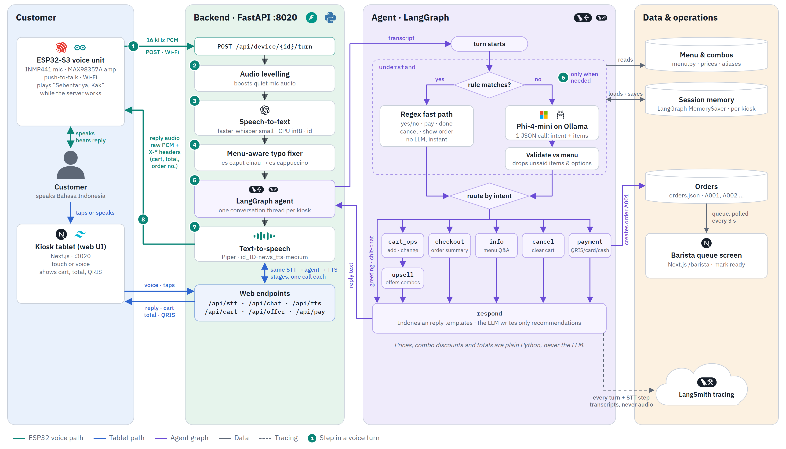

# Kopi Pagi: AI voice self-service coffee kiosk

A prototype self-service kiosk for an Indonesian coffee shop. Customers order by **talking, typing or tapping**
in **Bahasa Indonesia**. The kiosk understands the order, offers combos, takes payment (simulated QRIS, card or
cash) and sends the order to a barista screen. The ordering hardware can be a tablet, a **push-to-talk ESP32-S3
box**, or both.

All AI runs locally and is free: **faster-whisper** hears, **Phi-4-mini** on Ollama understands, **Piper** speaks.
LangGraph keeps the conversation and the cart; prices and totals are plain Python.

<picture>
  <source media="(prefers-color-scheme: dark)" srcset="docs/architecture-dark.png">
  
</picture>

## Contents

- [Architecture](#architecture)
- [How one voice turn works](#how-one-voice-turn-works)
- [How the agent works](#how-the-agent-works)
- [Tech stack](#tech-stack)
- [Project structure](#project-structure)
- [Getting started](#getting-started)
- [Configuration](#configuration)
- [Speech-to-text accuracy](#speech-to-text-accuracy)
- [API](#api)
- [Known limits](#known-limits)

## Architecture

The system has four parts, shown left to right in the diagram above.

| Zone | What it does |
|---|---|
| **Customer** | An **ESP32-S3 voice unit** (INMP441 mic, MAX98357A amp, push-to-talk button) and/or a **Next.js kiosk tablet** (touch + voice). Neither runs any AI. |
| **Backend** (FastAPI, port 8020) | The speech pipeline: audio levelling → faster-whisper → menu-aware typo fixer → LangGraph agent → Piper. The ESP32 uses one endpoint for the whole turn; the tablet calls one endpoint per stage. |
| **Agent** (LangGraph) | Decides what the customer wants, updates the cart, offers combos, handles checkout and payment, and writes the reply. |
| **Data & operations** | Menu and combos, per-kiosk session memory, the order book (`orders.json`), the barista queue screen, and optional LangSmith tracing. |

Three design decisions shape everything:

1. **The LLM never touches money.** Phi-4-mini only classifies the intent and picks numbered menu items. Prices,
   combo discounts, totals and almost every reply sentence come from Python templates, so they are always exact.
2. **The LLM is called only when needed.** Phi-4-mini takes 5–15 s per call on the dev PC (RTX 3050 6 GB), so
   common answers ("iya boleh", "bayar pakai QRIS", "sudah itu aja") are handled by regex rules instantly.
3. **Voice and touch share one cart.** Every input, spoken or tapped, writes into the same LangGraph checkpoint,
   one thread per kiosk.

## How one voice turn works

The numbers match the badges in the diagram (ESP32 path). Timings are from tests on the dev PC.

| # | Step | Time |
|---|---|---|
| 1 | The customer holds the button and speaks. The ESP32 records 16 kHz / 16-bit mono PCM into PSRAM and, on release, posts it over Wi-Fi to `POST /api/device/{id}/turn`. While it waits, it plays a cached "Sebentar ya, Kak". | on release |
| 2 | **Audio levelling** removes DC offset and raises quiet recordings to speaking level, so the voice detector doesn't drop soft words. | < 10 ms |
| 3 | **Speech-to-text**: faster-whisper `small` (CPU, int8, Indonesian), biased toward menu names with `hotwords` and beam search. | ~3 s |
| 4 | **Typo fixer** (`app/stt_fix.py`) respells misheard menu words, options and answers: "es caput cinau" → "es cappuccino". | < 5 ms |
| 5 | **LangGraph agent** updates the cart and writes the reply (see below). | instant – 15 s |
| 6 | Only when no rule matches: **one Phi-4-mini call** on Ollama in JSON mode, then checked against the menu. | 5–15 s |
| 7 | **Text-to-speech**: Piper (`id_ID-news_tts-medium`) speaks the reply as raw 16 kHz PCM. | < 1.5 s |
| 8 | The audio streams straight into the ESP32 speaker. Transcript, reply, cart, total, stage and order number travel in `X-*` response headers. | streamed |

The **tablet** goes through the same stages with one call each: `/api/stt` (transcribe), `/api/chat` (agent),
`/api/tts` (speak). Taps go straight to the agent through `/api/cart`, `/api/offer` and `/api/pay`.

## How the agent works

```
                 ┌─ rule matches ──► regex fast path ───────────┐
understand ──────┤                                              ├─► route by intent
                 └─ otherwise ─────► Phi-4-mini (1 JSON call) ──┘        │
                                     ► validate vs menu                  │
   ┌─────────────────────────────────────────────────────────────────────┘
   ├─► cart_ops ─► upsell ─► respond
   ├─► checkout ───────────► respond
   ├─► info ───────────────► respond
   ├─► cancel ─────────────► respond
   ├─► payment ────────────► respond      (creates the order, e.g. A001)
   └───────────────────────► respond      (greeting / chit-chat)
```

- **understand**: regex rules handle yes/no to an offer, the payment method, "that's all", "cancel" and "show my
  order" with no LLM call. Everything else goes to **one Phi-4-mini call in JSON mode**, which returns one of 14
  intents plus items, options and a target. The result is then **validated against the menu**: products the
  customer never said are re-pointed or dropped, and options (iced, large, oat milk, less sugar) are kept only if
  they appear in the customer's own words, because small models copy them from context.
- **cart_ops / upsell / checkout / payment / info / cancel**: plain Python. `payment` creates the order in
  `data/orders.json`; the barista screen (`/barista`) polls the queue every 3 s.
- **respond**: Indonesian templates for every transactional turn. Phi-4-mini writes free text only for
  recommendations and off-menu chat, grounded on the menu.

**Combos** are applied automatically, and offered when the customer is one item away:

| Combo | Contents | Discount |
|---|---|---|
| Paket Pagi | any coffee + Butter Croissant or Banana Bread | Rp8.000 |
| Paket Makan Siang | any drink + Chicken Pesto Sandwich | Rp10.000 |
| Paket Santai | any non-coffee drink + Chocolate Muffin or Cinnamon Roll | Rp6.000 |

## Tech stack

| Layer | Tool | Role |
|---|---|---|
| Voice hardware | **ESP32-S3** + Arduino core 3.0 | push-to-talk mic and speaker over Wi-Fi |
| Kiosk UI | **Next.js 14** + **Tailwind CSS** | tablet kiosk (port 3020) and barista screen |
| API | **FastAPI** (Python 3.12) | HTTP API for tablet and ESP32 (port 8020) |
| Speech-to-text | **faster-whisper** `small` | OpenAI Whisper weights, CPU int8, Indonesian |
| Agent | **LangGraph** + **LangChain** | state graph, per-kiosk memory, `ChatOllama` client |
| LLM | **Phi-4-mini** on **Ollama** | intent and menu-item extraction, local GPU |
| Text-to-speech | **Piper** `id_ID-news_tts-medium` | local Indonesian voice, CPU |
| Observability | **LangSmith** (optional) | traces of each agent turn and STT step, no audio |

## Project structure

```
prototype-selfservice/
├── backend/
│   ├── app/
│   │   ├── main.py        FastAPI routes (web kiosk, cart, payment, STT/TTS)
│   │   ├── device.py      ESP32 endpoint: raw PCM in, raw PCM out, per-device sessions
│   │   ├── agent.py       LangGraph graph: understand → route → nodes → respond
│   │   ├── speech.py      audio levelling, faster-whisper, Piper
│   │   ├── stt_fix.py     menu-aware transcript typo fixer
│   │   ├── menu.py        menu, combos, aliases, item matching
│   │   ├── cart.py        cart maths and combo discounts
│   │   ├── orders.py      order book and barista queue (data/orders.json)
│   │   └── config.py      settings from backend/.env
│   ├── tools/
│   │   ├── stt_eval.py    speech-to-text accuracy benchmark
│   │   └── device_sim.py  pretend to be an ESP32 from the command line
│   ├── requirements.txt
│   └── .env.example
├── frontend/              Next.js kiosk (app/page.tsx) and barista screen (app/barista)
├── esp32/
│   ├── kiosk_voice/       Arduino sketch + config.h (Wi-Fi, server, pins)
│   └── README.md          parts, wiring, flashing
└── docs/                  architecture diagrams
```

## Getting started

### Prerequisites

- Python 3.12, Node.js 18+
- [Ollama](https://ollama.com) with the model pulled: `ollama pull phi4-mini`
- Plenty of free RAM: Ollama (Phi-4-mini), Whisper, Piper and the Next.js dev server all run at once. On a
  16 GB PC, close other heavy apps.

### Install

```powershell
cd backend
python -m venv .venv
.\.venv\Scripts\pip install -r requirements.txt
.\.venv\Scripts\python -m piper.download_voices id_ID-news_tts-medium --data-dir models/piper
copy .env.example .env        # optional settings, e.g. LangSmith tracing
# Whisper "small" downloads itself into models/whisper on first use (~460 MB)

cd ..\frontend
npm install
```

### Run

```powershell
# terminal 1: backend (use --host 0.0.0.0 if an ESP32 will connect)
cd backend
.\.venv\Scripts\python -m uvicorn app.main:app --host 127.0.0.1 --port 8020

# terminal 2: frontend
cd frontend
npm run dev
```

Open **http://localhost:3020** for the kiosk and **http://localhost:3020/barista** for the barista queue.
The first LLM reply can take 1–2 minutes while Ollama loads the model; after that a turn takes about 5–15 s.

### ESP32 voice unit (optional)

A push-to-talk ESP32-S3 box can be the kiosk's voice over Wi-Fi. Start the backend with `--host 0.0.0.0`, allow
port 8020 through the firewall, and set Wi-Fi and the server address in `esp32/kiosk_voice/config.h`.
**[esp32/README.md](esp32/README.md)** covers parts, wiring, flashing with Arduino IDE or `arduino-cli`, and testing
without hardware via `backend/tools/device_sim.py`.

## Configuration

All settings are optional and live in `backend/.env` (copy `backend/.env.example`). Never commit `.env`.

| Variable | Default | Notes |
|---|---|---|
| `OLLAMA_MODEL` | `phi4-mini` | |
| `WHISPER_MODEL` | `small` | `base` is faster but much weaker at Indonesian |
| `WHISPER_LANGUAGE` | `id` | empty = auto-detect |
| `WHISPER_BEAM` | `5` | beam search width; `1` = greedy (a bit faster, more typos) |
| `STT_FIX` | `1` | respell menu words Whisper got wrong; `0` = raw Whisper text |
| `TTS_ENGINE` | `piper` | `edge` = free Microsoft online voices (needs internet), `none` |
| `PIPER_VOICE` | `id_ID-news_tts-medium` | local Indonesian voice |
| `EDGE_VOICE` | `id-ID-GadisNeural` | used when `TTS_ENGINE=edge` |
| `DEVICE_TOKEN` | empty | shared secret the ESP32 must send; empty = no auth (LAN prototype) |
| `DEVICE_IDLE_RESET_S` | `180` | an ESP32 silent this long starts a new order for the next customer |
| `LANGSMITH_TRACING` | off | `true` + `LANGSMITH_API_KEY` + `LANGSMITH_PROJECT` traces every agent turn and STT step to LangSmith. Transcripts are uploaded, audio never is. |

## Speech-to-text accuracy

Whisper `small` mishears foreign menu names in Indonesian speech ("caput cinau", "Eskopi", "Lemon T2", "kris").
Three layers fix most of it before the agent reads the text:

1. **Biasing**: `hotwords` built from the live menu, an example Indonesian order as the prompt, and beam search.
2. **Levelling**: quiet audio (an ESP32 mic at arm's length) is raised to speaking level for the voice detector.
3. **`app/stt_fix.py`**: snaps 1–4 word windows that sound like a menu item, option or answer back to the right
   spelling ("es caput cinau besar" → "es cappuccino besar", "dinginnya" → "dingin ya"). Everyday Indonesian words
   are never rewritten, and Whisper's own text is kept as `raw_text`.

Measure it with:

```powershell
cd backend
.\.venv\Scripts\python tools\stt_eval.py              # add --baseline to also score the old setup
```

The benchmark speaks 26 kiosk sentences with 2 Indonesian voices, clean and noisy (104 clips), and checks whether
the kiosk's own matchers find the right items, options and answers.

| Setup | Correct | Time per clip |
|---|---|---|
| Before (greedy decoding, fixed word list, no fixer) | 65% (68/104) | 3.1 s |
| Now | **97% (101/104)** | 3.3 s |

The clips are synthetic voices, so test with real customers too, and add any new mishearing as a test sentence or
to `_RESPELL` in `stt_fix.py`.

## API

Interactive docs at `http://localhost:8020/docs`.

| Area | Endpoints |
|---|---|
| Session & chat | `POST /api/session` · `GET /api/session/{id}` · `POST /api/chat` |
| Cart | `POST /api/cart/add` · `POST /api/cart/line` · `POST /api/offer/{accept\|decline}` |
| Checkout & payment | `POST /api/checkout` · `POST /api/pay/{qris\|card\|cash}` · `POST /api/pay/confirm` |
| Barista | `GET /api/orders/queue` · `POST /api/orders/{id}/{status}` |
| Speech | `POST /api/stt` (multipart audio) · `POST /api/tts` (returns WAV) |
| ESP32 | `POST /api/device/{id}/turn` · `POST /api/device/{id}/reset` · `GET /api/device/{id}` · `GET /api/device/prompt/{name}` |
| Other | `GET /api/menu` · `GET /api/health` |

## Known limits

This is a prototype.

- Sessions live in memory (LangGraph `MemorySaver`) and are lost on restart; orders persist in `backend/data/orders.json`.
- Payments are simulated. There's no real QRIS or card gateway yet.
- Phi-4-mini's free-form Indonesian is weak, so it only classifies intents and picks menu items; the code writes the sentences.
- Phi-4-mini sometimes merges split instructions ("dua matcha, satu kurang manis" → both less sweet).
- Speech accuracy is measured on synthetic voices; noisy speech can still be misheard as real words ("diminta" for "dingin").
- The ESP32 sketch compiles (core 3.0.7) but hasn't been tested on real hardware yet. Push-to-talk only, no wake word.
- Prices are spoken as words ("tiga puluh dua ribu rupiah") and QRIS as "kyuris".
- PyAV 19 is incompatible with faster-whisper's own decoder, so `speech.py` decodes audio itself. No ffmpeg needed.
